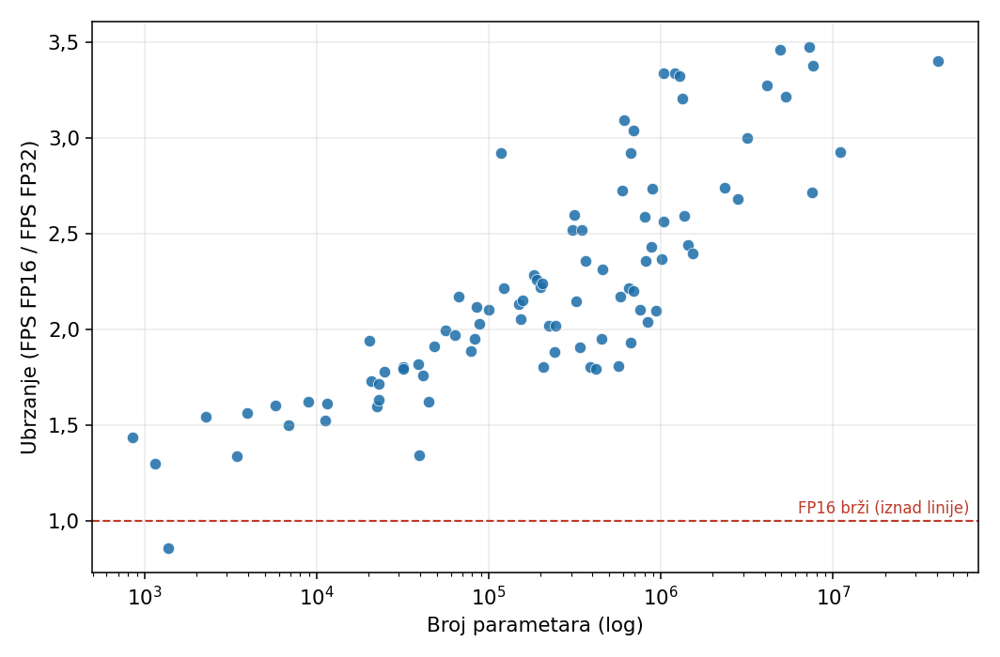
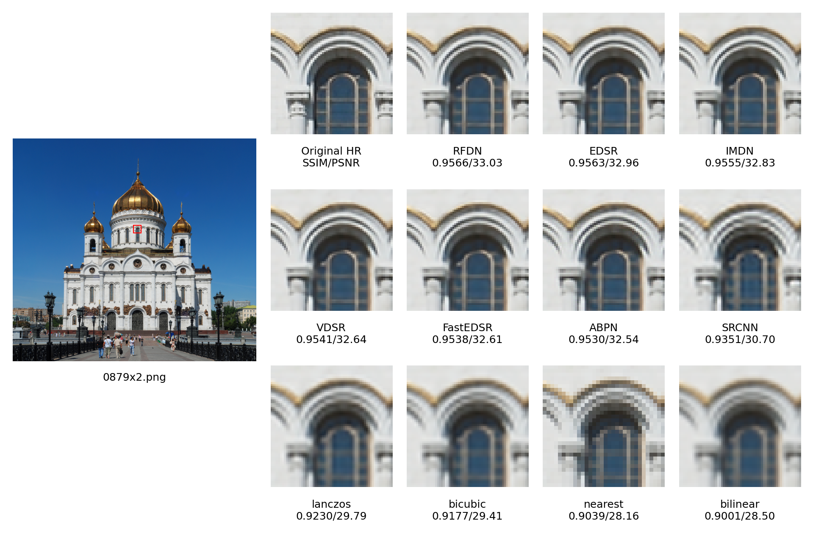
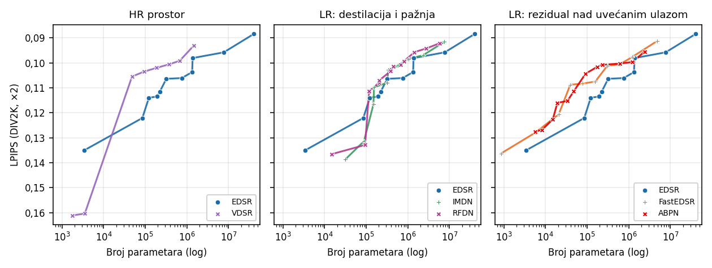
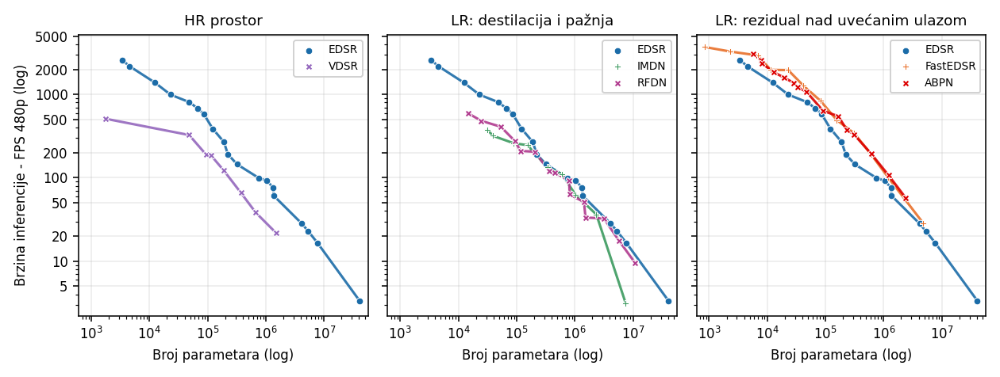
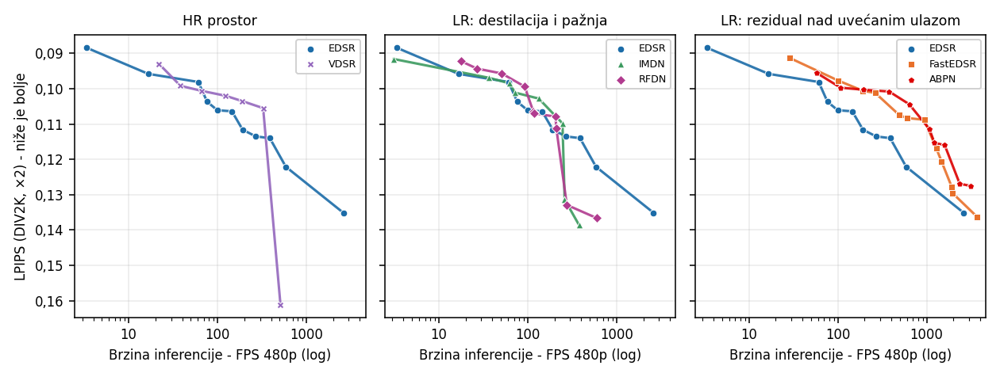
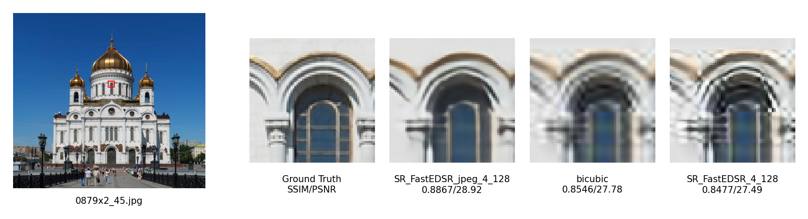
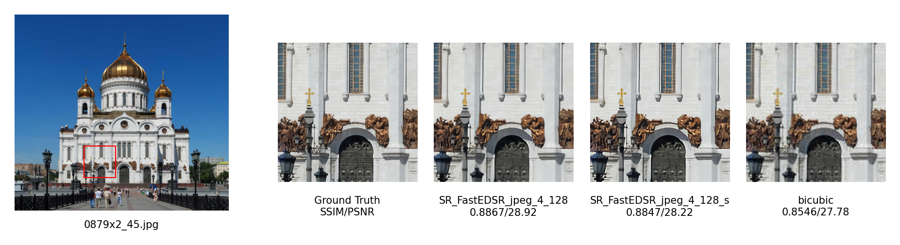
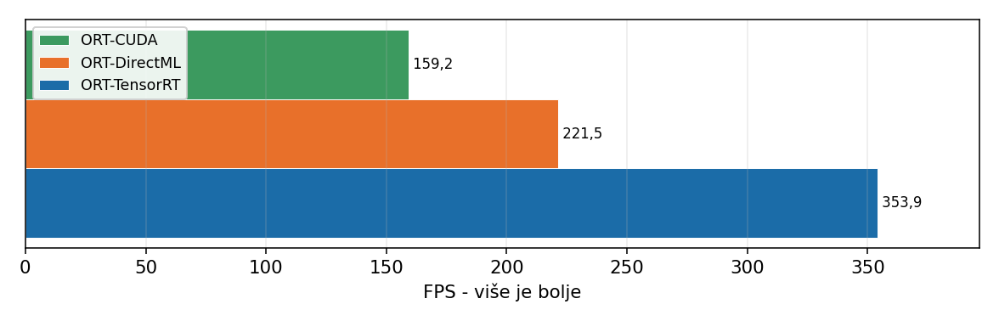
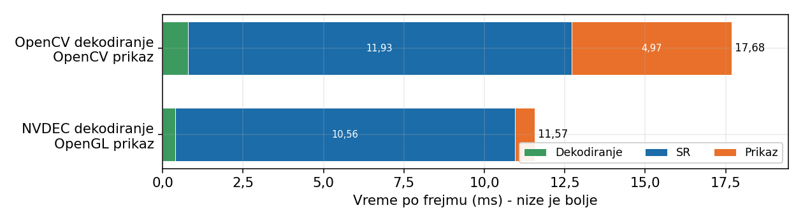
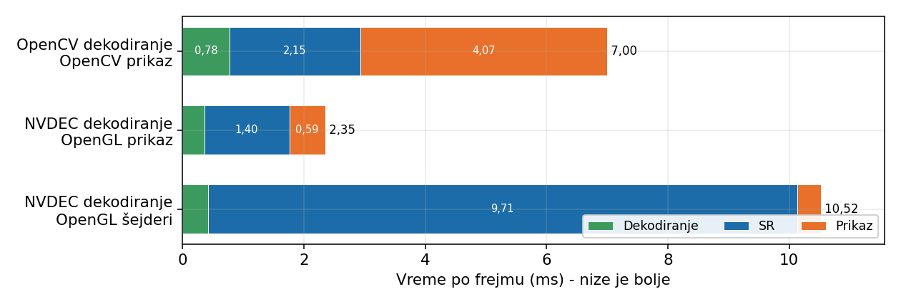

# Superrezolucija video-zapisa u realnom vremenu primenom konvolucionih neuronskih mreža

Kod uz master rad o primeni konvolucionih modela za superrezoluciju pojedinačne slike (SISR) na uvećanje
video-zapisa u realnom vremenu. Model se primenjuje nezavisno nad svakim frejmom, pa se izbor modela ne zasniva
na najboljem kvalitetu, već na kvalitetu koji se postiže unutar vremenskog budžeta jednog frejma (~33.3 ms za 30 FPS,
~16.7 ms za 60 FPS).

LaTeX izvor rada je u `tex/MasterRad.tex`.

Rad odgovara na pitanja:

- Kako se kvalitet i brzina standardnih arhitektura menjaju sa njihovom veličinom?
- Koje osobine arhitekture određuju brzinu pri zadatom kvalitetu, i da li su arhitekture efikasne po broju parametara
  efikasne i po vremenu izvršavanja?
- Koliki se kvalitet može postići unutar vremenskog budžeta prikaza, i koliki deo budžeta odlazi na korake van same
  inferencije?
- U kojoj meri izvršno okruženje (PyTorch, ONNX Runtime, TensorRT, NCNN) i numerička preciznost utiču na brzinu?

## Brzi početak

Potreban je Python 3.12.

### Video-plejer

Za plejer nije potrebno treniranje ni datasetovi, dovoljni su istrenirani modeli:

1. Preuzeti modele sa
   [SharePoint-a](https://pmfedu-my.sharepoint.com/:f:/g/personal/igor_jovanovic_pmf_edu_rs/IgBzRJMo-mxaR63KIe2Bu76uAbCnGjuVHjfk00zWbs2GmGk?e=vASt3k).
2. Preuzeti folder `pth/` staviti u `exports/`.
3. Instalirati zavisnosti prema grafičkoj kartici (tabele ispod).
4. Pokrenuti GUI iz korena projekta:

   ```bash
   python videoplayer_gui.py
   ```

U GUI-ju se bira video, zatim arhitektura i model, pa runtime, dekoder i prikaz, i pokreće dugmetom **Play**.
Runtime-ovi, dekoderi i prikazi koji na računaru nisu dostupni (paket nije instaliran ili ne ide uz izabrani model
ili runtime) prikazani su sivo.

Prvo pokretanje modela za datu rezoluciju videa traje duže, jer se model izvozi (ONNX, TensorRT engine, ncnn) i
kešira u `exports/`; svako sledeće pokretanje koristi keš.

### Instalacija

#### NVIDIA grafička kartica

```bash
pip install -r requirements/torch-cuda.txt -r requirements/rt-tensorrt.txt -r requirements/nvdec.txt
```

U GUI-ju: runtime `tensorrt`, dekoder `nvdec`, prikaz `opengl` (brži kod malih modela) ili `cv2`.

#### Bez NVIDIA grafičke kartice (AMD, Intel)

TensorRT, NVDEC i CUDA rade samo na NVIDIA karticama, pa se umesto njih koriste runtime-ovi koji rade na bilo kojoj
grafičkoj kartici. PyTorch se instalira u verziji bez CUDA-e (`torch-cpu.txt`); on služi samo za učitavanje i izvoz
modela, a samu superrezoluciju radi grafička kartica preko izabranog runtime-a.

Windows:

```bash
pip install -r requirements/torch-cpu.txt -r requirements/rt-onnxruntime-directml.txt -r requirements/rt-ncnn.txt -r requirements/rt-opengl.txt
```

Linux (DirectML postoji samo na Windows-u):

```bash
pip install -r requirements/torch-cpu.txt -r requirements/rt-ncnn.txt -r requirements/rt-opengl.txt
```

U GUI-ju je dekoder uvek `pyav` (ili `cv2`), a runtime jedan od:

| Runtime                | Prikaz   | Modeli                          |
|------------------------|----------|---------------------------------|
| `opengl`               | `opengl` | samo `multiscale/SR_FastEDSR_*` |
| `onnxruntime-directml` | `cv2`    | svi (samo Windows)              |
| `ncnn-vulkan`          | `cv2`    | svi                             |

Runtime-ovi `tensorrt`, `tensorrt-pt2`, `onnxruntime-cuda`, `onnxruntime-tensorrt` i dekoder `nvdec` biće sivi.

### Treniranje i ostalo

| Namena                                          | Komanda                                                                |
|-------------------------------------------------|------------------------------------------------------------------------|
| Treniranje i evaluacija, NVIDIA grafička        | `pip install -r requirements/torch-cuda.txt -r requirements/train.txt` |
| Treniranje i evaluacija, bez NVIDIA grafičke    | `pip install -r requirements/torch-cpu.txt -r requirements/train.txt`  |
| Sve (NVIDIA): trening, analiza, svi runtime-ovi | `pip install -r requirements.txt`                                      |

Requirements su podeljene na delove u `requirements/`, pa se instalira samo ono što je potrebno. Uvek se bira **tačno
jedan** `torch-*.txt` (PyTorch sa CUDA-om ili bez), pa se na njega dodaju delovi po nameni. Pojedinačni delovi:

| Fajl                                             | Sadrži                                                                     |
|--------------------------------------------------|----------------------------------------------------------------------------|
| `torch-cuda.txt` / `torch-cpu.txt`               | PyTorch sa CUDA 13.0 (NVIDIA) / samo CPU                                   |
| `train.txt`                                      | treniranje, evaluacija, inferenca (torchmetrics, matplotlib, pandas...)    |
| `analysis.txt`                                   | grafici i analiza CSV rezultata                                            |
| `player.txt`                                     | osnova plejera: PyAV i cv2 dekodiranje, cv2 prikaz, zvuk, ONNX izvoz       |
| `rt-tensorrt.txt`                                | runtime `tensorrt` (NVIDIA)                                                |
| `rt-tensorrt-pt2.txt`                            | runtime `tensorrt-pt2`; traži TensorRT 10.13, pa nije u `requirements.txt` |
| `rt-onnxruntime-{gpu,directml,openvino,cpu}.txt` | ONNX Runtime; **samo jedan** po okruženju (paketi dele isti modul)         |
| `rt-ncnn.txt`                                    | runtime `ncnn-vulkan` (bilo koja Vulkan grafička)                          |
| `rt-opengl.txt`                                  | runtime `opengl` (GLSL šejderi, bilo koja OpenGL grafička)                 |
| `nvdec.txt`                                      | dekoder `nvdec` i zero-copy OpenGL prikaz (NVIDIA)                         |

Svaki `rt-*.txt` i `nvdec.txt` već uključuje `player.txt`, a delovi se mogu slobodno kombinovati.

## Sadržaj

1. [Interpolacijske metode](#interpolacijske-metode)
2. [Arhitekture](#arhitekture)
3. [Treniranje](#treniranje)
4. [Metrike kvaliteta](#metrike-kvaliteta)
5. [Merenje brzine i izbor preciznosti](#merenje-brzine-i-izbor-preciznosti)
6. [Poređenje arhitektura](#poređenje-arhitektura)
7. [Višeskalni modeli](#višeskalni-modeli)
8. [Superrezolucija JPEG-kompresovanih slika](#superrezolucija-jpeg-kompresovanih-slika)
9. [Izvršna okruženja za inferenciju](#izvršna-okruženja-za-inferenciju)
10. [Demonstracioni video-plejer](#demonstracioni-video-plejer)
11. [Superrezolucija pomoću OpenGL šejdera (mpv)](#superrezolucija-pomoću-opengl-šejdera-mpv)
12. [Zaključak](#zaključak)
13. [Pokretanje](#pokretanje)

## Interpolacijske metode

Klasične metode služe kao bazna linija. Implementirane su u klasi `RegularModel` (`models/regular_models.py`):

- **Nearest Neighbor** - svaki novi piksel dobija vrednost najbližeg piksela; najbrža, ali daje blokove.
- **Bilinear** - težinska kombinacija 4 najbliža piksela; glađe, ali zamućeno.
- **Bicubic** - kubno jezgro nad 4×4 okolinom; najčešća metoda i referenca u literaturi.
- **Lanczos** - prozorsko sinc jezgro; bolje čuva ivice, ali može dati prstenovanje (*ringing*).

Zajedničko ograničenje im je da izlaz određuju samo na osnovu lokalnih piksela, pa ne mogu rekonstruisati fine
teksture kojih nema u ulazu.

## Arhitekture

Svi modeli su registrovani u `MODEL_REGISTRY` (`models/__init__.py`) i instanciraju se po imenu klase iz YAML
konfiguracije. Konfiguracije se označavaju sa `B/nf` - broj blokova / broj kanala.

| Model    | Klasa                              | Fajl                       | Ulaz mreže            | Izlaz                   |
|----------|------------------------------------|----------------------------|-----------------------|-------------------------|
| SRCNN    | `SR_SRCNN`                         | `models/srcnn/model.py`    | bikubno uvećana slika | SR slika                |
| VDSR     | `SR_VDSR`                          | `models/vdsr/model.py`     | bikubno uvećana slika | rezidual + bicubic      |
| EDSR     | `SR_EDSR`, `SR_EDSR_Multi`         | `models/edsr/model.py`     | LR slika              | SR slika (PixelShuffle) |
| IMDN     | `SR_IMDN`, `SR_IMDN_Multi`         | `models/imdn/model.py`     | LR slika              | SR slika (PixelShuffle) |
| RFDN     | `SR_RFDN`, `SR_RFDN_Multi`         | `models/rfdn/model.py`     | LR slika              | SR slika (PixelShuffle) |
| ABPN     | `SR_ABPN`, `SR_ABPN_Multi`         | `models/abpn/model.py`     | LR slika              | rezidual + nearest      |
| FastEDSR | `SR_FastEDSR`, `SR_FastEDSR_Multi` | `models/edsr/fast_edsr.py` | LR slika              | rezidual + bilinear     |

- **SRCNN** ([rad](https://arxiv.org/pdf/1501.00092)) - tri konvolucije (9×9, 1×1, 5×5) nad bikubno uvećanom slikom.
  Ovde sa paddingom i nad sva tri RGB kanala, umesto samo nad Y kanalom.
- **VDSR** ([rad](https://arxiv.org/pdf/1511.04587)) - 20 konvolucija 3×3 nad bikubno uvećanom slikom; uči rezidual
  `I_HR - I_bic`.
- **EDSR** ([rad](https://arxiv.org/pdf/1707.02921)) - SRResNet bez batch normalizacije; rezidualni blokovi rade u LR
  prostoru, uvećanje sub-pikselnom konvolucijom (PixelShuffle) na kraju, pa završna konvolucija u HR prostoru.
- **IMDN** ([rad](https://arxiv.org/pdf/1909.11856)) - destilacija obeležja deljenjem kanala unutar IMDB blokova i
  CCA (contrast-aware channel attention).
- **RFDN** ([rad](https://arxiv.org/pdf/2009.11551)) - destilacija preko 1×1 konvolucija (FDC), plitki rezidualni
  blokovi (SRB) i ESA (enhanced spatial attention).
- **ABPN** ([rad](https://arxiv.org/pdf/2105.09750)) - „VDSR premešten u LR prostor“: niz običnih 3×3 konvolucija +
  ReLU bez skip veza, rezidual se posle PixelShuffle sabira sa nearest-neighbor uvećanim ulazom.
- **FastEDSR** (sopstvena modifikacija) - „olakšani EDSR premešten u LR prostor“. U odnosu na EDSR uklonjene su
  završna konvolucija posle PixelShuffle (radi nad `s²` puta više piksela), konvolucija posle tela i duga rezidualna
  veza. Konvolucija ispred PixelShuffle direktno daje `3·s²` kanala reziduala koji se sabira sa **bilinearno**
  uvećanim ulazom - bilinearnu osnovu GPU dobija besplatno pri čitanju teksture, što je bitno za
  [GLSL šejdere](#superrezolucija-pomoću-opengl-šejdera-mpv). Nijedna konvolucija ne radi nad HR slikom.

Detaljniji opis svake arhitekture je u komentarima klasa i u poglavlju 3 rada.

## Treniranje

- **Skup podataka:** DIV2K - 800 slika za treniranje, 100 za validaciju (~2K rezolucija). Preuzima se automatski.
- **Isečci:** HR isečak 96×96, LR isečak bikubnim smanjivanjem (48×48, 32×32, 24×24 za ×2, ×3, ×4). Nasumično
  isecanje, horizontalna refleksija i rotacije za 90°. Sva tri RGB kanala, vrednosti u `[0, 1]`.
- **Parametri:** ℓ1 gubitak, Adam, batch 16, lr `1e-4` prepolovljen posle 300 i 600 epoha, ukupno 800 epoha (1 epoha = 1
  isečak po slici = 50 ažuriranja). SRCNN se trenira dvostruko duže. Validacija svakih 50 epoha, čuva
  se model sa najvećim SSIM-om.

Implementacija: `scripts/training/training_script.py`, `utils/trainers/`, `datasets/`. Konfiguracija u `config/*.yaml`
(vidi [Pokretanje](#pokretanje)).

## Metrike kvaliteta

- **PSNR** - greška po pikselu (dB, veće je bolje).
- **SSIM** - sličnost lokalne strukture, Gausov prozor 11×11, σ=1.5 (veće je bolje).
- **LPIPS** - perceptualna sličnost u prostoru obeležja AlexNet-a (manje je bolje).

Izlaz se pre ocene odseca na `[0, 1]` i kvantizuje na 8 bita, kao pri prikazu. PSNR i SSIM se računaju nad **sva tri
RGB kanala**, bez odsecanja ivica, pa vrednosti nisu direktno uporedive sa radovima koji koriste Y kanal, ali jesu
međusobno uporedive za sve modele ovde. Implementacija: `utils/metrics.py`, `utils/evaluator.py` (`torchmetrics`).

## Merenje brzine i izbor preciznosti

Brzina se meri na **NVIDIA GeForce RTX 5070**: model se prevodi pomoću Torch-TensorRT, izvršava u FP16 nad ulazom
veličine jednog frejma koji je već na GPU-u; 10 zagrevajućih + 100 merenih prolaza (`utils/evaluator_perf.py`). Ovaj
FPS obuhvata samo inferenciju i predstavlja gornju granicu brzine u plejeru. „FPS 480p“ znači LR ulaz 854×480.

**FP32 vs FP16** (91 konfiguracija, ×2): najveće odstupanje je 0.002 dB PSNR, 0.0001 SSIM i 0.0001 LPIPS -
zanemarljivo. FP16 je u proseku **2.13 puta brži**, ubrzanje raste sa veličinom modela (3.4× za puni EDSR). Zato je
FP16 podrazumevana preciznost u svim daljim merenjima.

<p align="center"></p>

## Poređenje arhitektura

Svaka arhitektura je trenirana u većem broju konfiguracija različite dubine i širine. Sva poređenja su za ×2,
kvalitet na DIV2K validacionom skupu, brzina kao FPS 480p.

### Kvalitet u odnosu na interpolaciju

Najveće trenirane konfiguracije (gornja granica ispitanih, ne rangiranje):

| Model    | PSNR ↑ | SSIM ↑ | LPIPS ↓ |
|----------|-------:|-------:|--------:|
| Nearest  |  29.25 | 0.8727 |  0.1558 |
| Bilinear |  29.94 | 0.8687 |  0.2290 |
| Bicubic  |  31.04 | 0.8931 |  0.1863 |
| Lanczos  |  31.51 | 0.9009 |  0.2053 |
| SRCNN    |  32.40 | 0.9159 |  0.1360 |
| VDSR     |  34.04 | 0.9329 |  0.0930 |
| EDSR     |  34.40 | 0.9357 |  0.0884 |
| IMDN     |  34.27 | 0.9345 |  0.0916 |
| RFDN     |  34.48 | 0.9362 |  0.0907 |
| ABPN     |  34.03 | 0.9323 |  0.0930 |
| FastEDSR |  34.19 | 0.9339 |  0.0916 |

Svi neuronski modeli nadmašuju interpolaciju po sve tri metrike. Najveće konfiguracije povećavaju PSNR za 2.9-3.4 dB
u odnosu na bicubic i približno dvostruko smanjuju LPIPS, a međusobne razlike (najviše 0.46 dB) su znatno manje od
te prednosti. Poredak zavisi i od metrike - nearest ima bolji LPIPS od bicubic-a iako je vizuelno najgrublji, jer
LPIPS strože kažnjava zamućenje od blokova.

<p align="center"></p>

### Kvalitet i veličina modela

Najbolja konfiguracija po metrici unutar opsega broja parametara:

| Opseg     | Najbolji PSNR ↑      | Najbolji SSIM ↑      | Najbolji LPIPS ↓      |
|-----------|----------------------|----------------------|-----------------------|
| < 10K     | FastEDSR 4/8 (32.74) | FastEDSR 4/8 (0.920) | ABPN 2/16 (0.127)     |
| 10K-50K   | VDSR 5/32 (33.35)    | VDSR 5/32 (0.926)    | VDSR 5/32 (0.105)     |
| 50K-200K  | VDSR 5/64 (33.64)    | VDSR 5/64 (0.929)    | ABPN 8/48 (0.102)     |
| 200K-500K | VDSR 10/64 (33.84)   | VDSR 10/64 (0.931)   | FastEDSR 4/64 (0.096) |
| 500K-1M   | RFDN 2/96 (33.90)    | RFDN 2/96 (0.931)    | ABPN 4/128 (0.095)    |
| 1M-3M     | RFDN 4/128 (34.25)   | RFDN 4/128 (0.934)   | ABPN 4/256 (0.093)    |
| > 3M      | RFDN 4/256 (34.48)   | RFDN 4/256 (0.936)   | EDSR 32/256 (0.088)   |

Grafici dele arhitekture u tri panela: VDSR (radi nad uvećanom slikom), IMDN/RFDN (destilacija i pažnja) i
ABPN/FastEDSR (samo konvolucije + rezidual nad interpoliranim ulazom), sa EDSR-om kao zajedničkom referencom.

<p align="center"></p>

VDSR je najefikasniji po broju parametara (od ~50K naviše), jer rad nad uvećanom slikom povećava samo broj
izračunavanja, ne parametara. IMDN i RFDN su tek od ~100K parametara uporedivi sa EDSR-om, a FastEDSR i ABPN su bolji
od EDSR-a.

### Veličina i brzina modela

<p align="center"></p>

Broj parametara ne određuje brzinu. VDSR je ovde najsporiji, jer radi nad `s² = 4` puta više piksela. VDSR, IMDN i
RFDN gube brzinu po parametru ispod ~100K parametara. FastEDSR i ABPN su iznad EDSR-a u celom opsegu i gotovo se
poklapaju. Iznad ~1M parametara razlike se smanjuju, jer vreme sve više određuju same konvolucije.

### Kvalitet i brzina modela

Za izbor modela za plejer najbitnije je koliki se kvalitet postiže uz zadatu minimalnu brzinu:

<p align="center"></p>

Najbolji SSIM ↑ uz zadati minimalni FPS (480p):

| FPS      |        ≥20 |        ≥30 |        ≥60 |        ≥80 |       ≥120 |       ≥250 |       ≥500 |
|----------|-----------:|-----------:|-----------:|-----------:|-----------:|-----------:|-----------:|
| VDSR     |     0.9329 |     0.9307 |     0.9307 |     0.9290 |     0.9290 |     0.9265 |     0.9090 |
| EDSR     |     0.9326 |     0.9326 | **0.9326** |     0.9278 |     0.9274 |     0.9244 |     0.9213 |
| IMDN     |     0.9320 |     0.9320 |     0.9307 |     0.9293 |     0.9277 |     0.9190 |        --- |
| RFDN     | **0.9340** | **0.9327** |     0.9311 |     0.9304 |     0.9259 |     0.9183 |     0.9114 |
| FastEDSR |     0.9333 |     0.9320 |     0.9320 | **0.9320** |     0.9296 | **0.9296** |     0.9259 |
| ABPN     |     0.9319 |     0.9319 |     0.9301 |     0.9301 | **0.9301** |     0.9278 | **0.9262** |

Najbolji LPIPS ↓ uz zadati minimalni FPS (480p):

| FPS      |       ≥20 |       ≥30 |       ≥60 |       ≥80 |      ≥120 |      ≥250 |      ≥500 |
|----------|----------:|----------:|----------:|----------:|----------:|----------:|----------:|
| VDSR     |     0.093 |     0.099 |     0.101 |     0.102 |     0.102 |     0.105 |     0.161 |
| EDSR     |     0.098 |     0.098 |     0.098 |     0.106 |     0.106 |     0.114 |     0.122 |
| IMDN     |     0.097 |     0.097 |     0.099 |     0.103 |     0.103 |     0.131 |       --- |
| RFDN     |     0.094 |     0.096 |     0.099 |     0.099 |     0.108 |     0.133 |     0.137 |
| FastEDSR | **0.091** |     0.098 | **0.098** | **0.098** |     0.101 |     0.101 |     0.108 |
| ABPN     |     0.096 | **0.096** |     0.100 |     0.100 | **0.100** | **0.101** | **0.104** |

- **Kvalitet se sporo menja sa zahtevom za brzinom.** Uz ≥30 FPS najbolji SSIM je 0.9327, uz ≥250 FPS 0.9296 -
  osam puta veća brzina košta 0.0031 SSIM, manje od desetine prednosti nad bicubic-om.
- **IMDN i RFDN ne zadržavaju kvalitet pri većim brzinama.** Prate EDSR do ~200 FPS, a zatim naglo padaju (uz ≥250 FPS
  SSIM ~0.919 naspram 0.9296 kod FastEDSR-a); IMDN ne dostiže 500 FPS. VDSR je bolji od EDSR-a između
  ~80 i 300 FPS, ali iznad toga naglo gubi kvalitet.
- **Uz ≥80 FPS najbolji rezultat po svim metrikama daju isključivo ABPN i FastEDSR**, koji su međusobno praktično
  izjednačeni.

Za rad u realnom vremenu najbolji odnos kvaliteta i brzine imaju jednostavne arhitekture koje rade u LR prostoru,
sastoje se samo od konvolucija, aktivacija i sabiranja i predviđaju rezidual nad interpoliranim ulazom.

## Višeskalni modeli

Varijante `*_Multi` (inspirisane MDSR-om) imaju zajedničko telo i posebnu sub-pikselnu konvoluciju za svaki faktor
×2, ×3 i ×4. Faktor se prosleđuje modelu u `forward`, a pri treniranju se za svaki mini-batch nasumično bira jedan od
tri faktora.

Prosek po svim konfiguracijama, namenski (jedan faktor) vs višeskalni model iste konfiguracije, DIV2K:

| Faktor | PSNR namenski | PSNR multi | SSIM namenski | SSIM multi | LPIPS namenski | LPIPS multi |
|--------|--------------:|-----------:|--------------:|-----------:|---------------:|------------:|
| ×2     |         33.26 |  **33.27** |        0.9250 | **0.9252** |         0.1108 |  **0.1085** |
| ×3     |         29.59 |  **29.67** |        0.8481 | **0.8497** |     **0.2496** |      0.2501 |
| ×4     |         27.73 |  **27.86** |        0.7859 | **0.7893** |         0.3384 |  **0.3364** |

Više faktora se može objediniti u jednom modelu bez gubitka kvaliteta, što je posebno korisno u plejeru, gde
potreban faktor zavisi od rezolucije videa i ekrana.

## Superrezolucija JPEG-kompresovanih slika

Deo modela je treniran sa dodatnom JPEG kompresijom LR ulaza (kvalitet nasumično 20-95), dok HR ostaje isti
(`jpeg_degradation: true`). Arhitektura se ne menja. Evaluacija je na DIV2K sa JPEG-kompresovanim LR slikama (kvalitet
20-100), ×2:

| Model          | PSNR bazni |  PSNR jpeg | SSIM bazni | SSIM jpeg | LPIPS bazni | LPIPS jpeg |
|----------------|-----------:|-----------:|-----------:|----------:|------------:|-----------:|
| FastEDSR 4/32  |     28.382 | **29.108** |      0.804 | **0.826** |   **0.268** |      0.280 |
| FastEDSR 4/64  |     28.375 | **29.332** |      0.804 | **0.832** |   **0.262** |      0.273 |
| FastEDSR 4/128 |     28.388 | **29.543** |      0.804 | **0.837** |   **0.265** |      0.267 |
| FastEDSR 4/256 |     28.405 | **29.635** |      0.805 | **0.839** |       0.270 |  **0.263** |
| RFDN 2/128     |     28.366 | **29.408** |      0.804 | **0.842** |       0.265 |  **0.255** |

PSNR raste u proseku za 1.02 dB, SSIM za ~0.031, ali LPIPS se blago pogoršava - izlazi su vidljivo zamućeni, jer
model pri uklanjanju artefakata potiskuje i deo detalja.

<p align="center"></p>

Zato je isproban i trening sa **izoštrenom referentnom HR slikom** (`jpeg_s`, kao kod Real-ESRGAN-a; LR ulaz se
formira pre izoštravanja). U odnosu na `jpeg` modele LPIPS se smanjuje u proseku za ~0.007, a SSIM raste za još
~0.002, pa je LPIPS praktično na nivou baznih modela uz zadržan viši SSIM.

<p align="center"></p>

Tabele i grafici: `results/analysis/jpeg/`.

## Izvršna okruženja za inferenciju

U plejeru se model izvršava preko izvršnog okruženja. Polazna tačka je ONNX zapis:

- **ONNX Runtime** - učitava ONNX direktno; hardver se bira izvršnim provajderom (CUDA, TensorRT, DirectML, OpenVINO,
  CPU).
- **TensorRT** - iz ONNX-a gradi engine optimizovan za konkretnu karticu (fuzija slojeva, izbor kernela,
  optimizacija memorije). Koristi se kroz ONNX Runtime ili direktno, preko sopstvene implementacije nad TensorRT
  Python API-jem (PyTorch za memoriju i CUDA tokove).
- **NCNN + Vulkan** - ONNX se konvertuje u `.param` + `.bin`; radi na GPU-ima svih proizvođača i na više operativnih
  sistema.

Poređenje u plejeru (RTX 5070, ×2, 480p, korak superrezolucije):

- TensorRT provajder ONNX Runtime-a je najbrži provajder: **353.9 FPS**, 1.5× brži od DirectML-a (221.5) i 2.2× od
  CUDA provajdera (159.2).
- Direktni TensorRT engine je brži od TensorRT-a kroz ONNX Runtime: +4.3% kod malih modela (707.2 vs 677.9 FPS),
  +2.7% kod velikih - fiksni troškovi po pozivu više se vide kod malih modela.
- NCNN je u odnosu na DirectML (jedina dva okruženja koja nisu vezana za jednog proizvođača) ~7.8× sporiji kod malih
  (55.7 vs 396.4 FPS) i ~3.4× kod velikih modela (28.3 vs 98.5 FPS). Prednost mu je prenosivost van Windows-a.

<p align="center"></p>

Grafici: `results/analysis/runtimes/`. Implementacija: `videoplayer/backends/`.

## Demonstracioni video-plejer

Superrezolucija je dodatni korak u video grani, između dekodiranja i prikaza. Pošto model uvećava celobrojnim
faktorom, plejer bira **najmanji podržani faktor koji nije manji od potrebnog**, a izlaz modela se zatim samo
smanjuje na dimenzije ekrana (npr. 854×480 na 1920×1080 → faktor 3). Zato su višeskalni modeli posebno pogodni.

Sa budžetom frejma se ne poredi samo inferencija, već ukupno vreme - dekodiranje, prenosi CPU↔GPU, završno
skaliranje i prikaz. Implementirane su dve varijante:

### Osnovna varijanta: dekodiranje i prikaz na CPU-u

- Nit za učitavanje dekodira frejmove (`cv2.VideoCapture`, ili PyAV) tempom videa i čuva samo poslednji frejm; ako je
  model spor, frejmovi se preskaču umesto da prikaz zaostaje.
- Zvuk se dekodira PyAV-om i reprodukuje preko `sounddevice`, nezavisno od superrezolucije.
- Glavna petlja obrađuje samo nove frejmove, bikubno ih skalira (`cv2.resize`) i prikazuje (`cv2.imshow`).
- Podržava TensorRT, ONNX Runtime i NCNN. Predobrada i postobrada (BGR↔RGB, `uint8`↔float, `HWC`↔`NCHW`, clamp) su
  deo izvezenog grafa preko `VideoWrapper` (`videoplayer/backends/wrappers.py`), pa se izvršavaju na GPU-u, a između
  CPU-a i GPU-a se prenosi `uint8`.

### Zero-copy varijanta: dekodiranje i prikaz na GPU-u

Cela video grana ostaje na grafičkoj kartici:

1. **NVDEC** (PyNvVideoCodec) dekodira frejm direktno u planarni RGB tenzor `(3, H, W)` na GPU-u (preko DLPack-a).
2. TensorRT engine izvršava model na zasebnom CUDA toku; ulaz i izlaz su adrese PyTorch tenzora.
3. Izlaz (FP16) se bikubno smanjuje na GPU-u (`F.interpolate`).
4. Frejm se prepakuje u RGBA i kopira u OpenGL teksturu preko **CUDA-OpenGL interoperabilnosti**
   (`cudaGraphicsGLRegisterImage`, `cudaMemcpy2DToArray`), pa se iscrtava u GLFW prozoru.

Faze obrade frejma, FastEDSR 4/128, 480p:

| Faza                         |      Osnovna |    Zero-copy |
|------------------------------|-------------:|-------------:|
| dekodiranje                  |      0.78 ms |      0.48 ms |
| sr (+ prenosi)               |     11.93 ms |     10.56 ms |
| prikaz (skaliranje + prikaz) |      4.97 ms |      0.67 ms |
| **ukupno**                   | **17.68 ms** | **11.57 ms** |

Zero-copy varijanta uvodi isti model u budžet od 16.7 ms za 60 FPS. Dobitak je relativno najveći kod malih modela,
kod kojih inferencija čini manji deo ukupnog vremena.

<p align="center"></p>

Implementacija: `videoplayer/` (vidi [Pokretanje](#video-plejer)).

## Superrezolucija pomoću OpenGL šejdera (mpv)

Demonstracioni plejer nema mogućnosti pravog plejera (titlovi, plejliste...), pa je implementiran i generator koji
istrenirani **FastEDSR** prevodi u niz GLSL šejdera fragmenata za plejer [mpv](https://mpv.io/). Mreža se tada
izvršava bez ikakvog izvršnog okruženja za neuronske mreže - dovoljan je jedan `.glsl` fajl:

```bash
mpv --glsl-shaders="~~/shaders/FastEDSR.glsl" video.mp4
```

- Mape obeležja se čuvaju u RGBA teksturama, po 4 kanala (grupe).
- Svaki šejder računa jednu izlaznu grupu: konvolucija 3×3 u pikselu postaje zbir proizvoda `mat4 * vec4` za svih 9
  pozicija jezgra i svaku ulaznu grupu, sa težinama upisanim kao konstante.
- Kod širih slojeva ulazne grupe se dele u delove od najviše 8 tekstura; delimične sume se čuvaju u pomoćnim
  teksturama.
- Završni prolaz objedinjuje PixelShuffle i sabiranje sa bilinearno uvećanim ulazom (`MAIN_tex(MAIN_pos)`).
- Višeskalni model upisuje sve tri grane za uvećanje u isti fajl, a `//!WHEN` bira koja se izvršava.

**Ograničenja:** broj prolaza raste sa kvadratom broja kanala (sloj 64→64 = 32 prolaza, 128→128 = 128 prolaza), pa
široki modeli nisu izvodljivi u realnom vremenu. I kod manjih modela šejderi su sporiji od TensorRT-a: FastEDSR 4/32
na 480p - superrezolucija 9.71 ms naspram 1.40 ms u zero-copy varijanti (bez tenzorskih jezgara, svaki prolaz čita i
upisuje teksture). Ukupnih 10.52 ms je ipak dovoljno za 60 FPS.

<p align="center"></p>

Generatori: `scripts/glsl/` (vidi [Pokretanje](#mpv-šejderi)).

## Zaključak

- Svi neuronski modeli nadmašuju interpolaciju; najveće konfiguracije donose +2.9-3.4 dB PSNR u odnosu na bicubic i
  dvostruko manji LPIPS, a razlike između arhitektura su znatno manje od te prednosti.
- **Efikasnost po parametrima nije efikasnost po vremenu.** VDSR je najefikasniji po parametrima, ali najsporiji.
  IMDN i RFDN iznad ~200 FPS naglo gube kvalitet. Najbolji odnos kvaliteta i brzine imaju **ABPN i FastEDSR**.
- Više faktora uvećanja se može objediniti u jednom višeskalnom modelu bez gubitka kvaliteta; trening sa JPEG
  degradacijom povećava PSNR na kompresovanim ulazima u proseku za 1.02 dB.
- Izvršno okruženje i preciznost utiču na brzinu podjednako kao arhitektura: FP16 je ~2.13× brži od FP32, na NVIDIA
  karticama je najbrži direktni TensorRT engine, a NCNN donosi prenosivost uz manju brzinu.
- Koraci van inferencije čine značajan deo budžeta: zero-copy varijanta smanjuje ukupno vreme FastEDSR 4/128 na 480p
  sa 17.68 na 11.57 ms.
- Modeli su primenjeni u dva sistema: demonstracionom plejeru koji celu obradu obavlja na GPU-u i generatoru GLSL
  šejdera za mpv.

---

## Pokretanje

### Instalacija

Videti [Brzi početak](#brzi-početak): zavisnosti se biraju po nameni iz `requirements/`, a `requirements.txt`
instalira sve za NVIDIA računar.

Datasetovi se čuvaju u `data/`, ili na lokaciji iz `config/data.yaml` (`path: D:\datasets\super-resolution`).
Podržani test skupovi: DIV2K, Set5, Set14, BSD100, Urban100.

### Treniranje

```bash
python scripts/training/training_script.py
```

Konfiguracija je YAML sa `defaults` sekcijom i listom `models`; svaki model može da pregazi bilo koju vrednost iz
`defaults`:

```yaml
defaults:
  mode: psnr              # psnr | gan
  multiscale: false       # true -> *_Multi modeli, nasumičan faktor 2/3/4 po batch-u
  jpeg_degradation: false # true -> JPEG kompresija LR ulaza
  training:
    patch_size: 96
    batch_size: 16
    epochs: 800
    lr: 0.0001
    scheduler_milestones: [ 300, 600 ]
    validate_every: 100
  data:
    num_workers: 2
    train_preload: True
    val_preload: True

models:
  - name: SR_FastEDSR
    checkpoint_name: SR_FastEDSR_2x_4_32
    params: { upscale_factor: 2, num_blocks: 4, nf: 32 }
```

| Fajl                                                        | Namena                        |
|-------------------------------------------------------------|-------------------------------|
| `training_2x.yaml`, `training_3x.yaml`, `training_4x.yaml`  | modeli za jedan faktor        |
| `training_2x_ABPN.yaml`, `training_2x_VDSR.yaml`            | ABPN / VDSR konfiguracije     |
| `training_multiscale.yaml`                                  | višeskalni modeli             |
| `training_multi_jpeg.yaml`, `training_multi_jpeg_ABPN.yaml` | višeskalni + JPEG degradacija |

Checkpoint-i se čuvaju u `checkpoints/{1x,2x,3x,4x,multiscale}/`, logovi i grafici treniranja u `logs/`.

### Evaluacija i analiza

- `scripts/evaluation/evaluate_script.py` - PSNR/SSIM/LPIPS na test skupu (opciono sa JPEG degradacijom) i FPS/VRAM;
  rezultati u `results/results_{faktor}x_{skup}[_half].csv`.
- `scripts/evaluation/evaluate_script_video.py` - vreme po fazama (`decode`, `sr`, `display`, `total`) u plejeru za
  izabrani runtime/dekoder; rezultati u `results/results_{faktor}x_video_ms.csv`.
- `scripts/analysis/` - grafici i LaTeX tabele iz CSV rezultata u `results/analysis/` (zajednički kod u
  `utils/analysis/`).

Podešavanja su konstante na vrhu svake skripte.

### Inferenca

- `scripts/inference/inference_script.py` - uvećava sve slike iz `inference/input/` u `inference/output/`.
- `scripts/inference/comparison_script.py` - grid isečaka iste slike uvećane različitim metodama i modelima
  (`results/comparisons/`).

### Video plejer

```bash
python videoplayer_gui.py      # GUI za izbor modela, runtime-a i videa
python videoplayer/run.py      # bez GUI-ja
```

`videoplayer/run.py` bez argumenata koristi konstante na vrhu fajla, a sve se može zadati i iz komandne linije
(`--video`, `--model`, `--runtime`, `--decoder`, `--display`, `--scales`, `--no-audio`, `--windowed`).
Podržane kombinacije:

| Runtime                                            | Dekoder          | Prikaz | Plejer                | Varijanta                               |
|----------------------------------------------------|------------------|--------|-----------------------|-----------------------------------------|
| tensorrt, tensorrt-pt2, ncnn-vulkan, onnxruntime-* | pyav, cv2        | cv2    | `VideoPlayerCV2`      | osnovna                                 |
| tensorrt                                           | nvdec            | cv2    | `VideoPlayerNvdecCV2` | NVDEC + CPU prikaz                      |
| tensorrt                                           | nvdec            | opengl | `VideoPlayerNvdecGL`  | zero-copy                               |
| opengl                                             | nvdec, pyav, cv2 | opengl | `VideoPlayerGL`       | GLSL šejderi (samo `SR_FastEDSR_Multi`) |

- `tensorrt-pt2` je torch-tensorrt `.pt2` putanja, za velike modele kod kojih izgradnja engine-a ostane bez memorije.
- Izvezeni modeli se keširaju u `exports/{onnx,trt,pt2}/{cv2,nvdec}/` i `exports/ncnn/`, posebno za svaku
  rezoluciju i faktor.
- Kontrole: `Space` pauza, `←`/`→` premotavanje, `↑`/`↓` veći skok, `F` fullscreen, `Q`/`Esc` izlaz.

### mpv šejderi

- `scripts/glsl/glsl_script_fastedsr_multi.py` - `SR_FastEDSR_Multi` (×2/×3/×4 u jednom fajlu)
- `scripts/glsl/glsl_script_fastedsr.py`, `glsl_script_fastedsr_1x.py` - `SR_FastEDSR` / `SR_FastEDSR_1x`
- `scripts/glsl/glsl_script_abpn_multi.py` - `SR_ABPN_Multi` (anchor = nearest umesto bilinear)
- `scripts/glsl/export_shader_gen.py` - ispisuje passove OpenGL plejera (`videoplayer/backends/shader_gen.py`) u
  čitljiv `.glsl` radi poređenja

Šejderi se upisuju u `exports/glsl/`.

### Van okvira rada

- **GAN trening** (`mode: gan`, `utils/trainers/trainer_gan.py`) - ESRGAN generator (`SR_ESRGAN`, RRDB) i
  `VGGDiscriminator` (`models/esrgan/`), gubitak u `loss/esrgan_loss.py`; može se primeniti i na druge generatore
  preko `pretrain_checkpoint`. Konfiguracije `training_GAN*.yaml`, `training_ESRGAN.yaml`.
- **`SR_FastEDSR_1x`** - varijanta bez uvećanja za uklanjanje JPEG artefakata (`training_1x_jpeg.yaml`).

### Struktura projekta

```
checkpoints/   sačuvani modeli (.pth) po faktoru i multiscale
config/        YAML konfiguracije za trening i data.yaml
datasets/      Dataset klase, preuzimanje, transformacije i JPEG degradacija
exports/       keš izvezenih modela za plejer i generisani GLSL šejderi
inference/     slike za inference i comparison skripte
logs/          logovi i grafici treniranja i evaluacije
loss/          gubitak za GAN trening
models/        implementacije modela i MODEL_REGISTRY
requirements/  zavisnosti po nameni (vidi Brzi početak)
results/       CSV rezultati, analysis/ (grafici, LaTeX tabele), comparisons/
scripts/       training, evaluation, inference, analysis, glsl
tex/           LaTeX izvor rada
utils/         trainer/evaluator klase, metrike, checkpoint i pomoćne funkcije
videoinput/    test video snimci
videoplayer/   plejer: players/, decode/, backends/, eval/, run.py
videoplayer_gui.py  GUI za pokretanje plejera
```
